# 视频链路

## 总览

```mermaid
flowchart LR
    DXGI["DXGI Desktop Duplication"] --> BGRA["KCaptureFrame / BGRA"]
    BGRA --> LOOP["CaptureLoop / KCaptureService"]
    LOOP --> SINK["KCaptureFrameSink"]
    SINK --> I420["FFmpeg swscale / I420"]
    I420 --> SOURCE["WebRTC VideoSource"]
    SOURCE --> ENC["H.264 encoder"]
    ENC --> RTC["WebRTC video track"]
    RTC --> DEC["H.264 decoder"]
    DEC --> PROCESS["RemoteFrameProcessor / shared I420 or BGRA fallback"]
    PROCESS --> D3D["KVideoRenderWidget / D3D11"]
```

## 被控端

`KDxgiDesktopDuplicator` 从当前默认输出采集桌面和指针，生成与 WebRTC 无关的 BGRA `KCaptureFrame`。CaptureLoop 负责帧率、超时和取消；`KCaptureService` 管理线程、generation、Sink 选择和停止。

WebRTC FrameSink 使用 FFmpeg `swscale` 按协商流配置缩放并转换为 I420。I420 帧通过核心媒体类型交给 WebRTC VideoSource，因此 DXGI adapter 不需要包含 WebRTC/libyuv 头文件。

静态桌面启动时，首帧后的短保护期可重推最近帧并刷新时间戳，避免软件编码器尚未输出时长期黑屏。保护期结束后仍以桌面变化驱动为主，不持续发送重复帧。

## H.264 编码

编码器优先尝试 Windows Media Foundation 的 `h264_mf`。初始化失败会完整释放失败上下文并自动回退到 `libx264`；软件路径使用 `ultrafast`、`zerolatency`、低延迟、无 B 帧和受控 GOP。

WebRTC 输入为 I420，编码器内部转换为 NV12。线上保持 H.264 和既有 SDP/Annex-B 处理，控制端不需要知道硬件或软件编码器的选择。

## 控制端

WebRTC H.264 decoder 输出 I420。默认 `--video-renderer=auto` 下，`KWebRtcRemoteFrameProcessor` 保留引用计数缓冲区的所有权，将只读 Y/U/V 平面交给 D3D11：三张 `R8_UNORM` 纹理按各自 stride 上传，像素着色器执行 BT.601 limited-range 转色。正常路径不分配整帧 BGRA，也不执行整帧 CPU `I420ToARGB()`；这不是采集到编码的 GPU 零拷贝，解码器原有 I420 拷贝及 CPU→GPU 上传仍存在。

`KDecodedVideoFrame` 同时支持 I420 与 BGRA，不暴露 WebRTC/D3D 类型。共享所有权和独立会话 token 保证缓冲区直到消费或丢弃才释放；清理使旧 token 失效，迟到帧不能再次显示。处理线程和 GUI 队列继续只保留最新待处理帧。

`--video-renderer=bgra` 强制使用原有 CPU 转色。I420 专属资源创建失败时，渲染器标记该帧所属会话回退，后续帧在处理线程转换 BGRA；不把转换搬到 GUI 线程，新会话可再次尝试 GPU。整个 D3D 设备失效仍按原有错误路径处理，BGRA 回退不代表无 GPU 的软件显示。格式不变、尺寸不变时复用纹理，清理时释放纹理。

开启 latency trace（包括 `--trace`）时，接收端始终使用 BGRA，以保留现有水印读取、移除及输入反馈语义。因而不能使用该模式证明 I420 GPU 路径的端到端延迟收益；若需观察 GPU 路径，可只开启 session/resource trace。着色器以现有 libyuv 行为为颜色基准，在转换 RGB 后执行双线性过滤，不在本轮增加 HDR 或 BT.709 元数据处理。

`KVideoRenderWidget` 在 GUI/渲染边界显示最新帧，并将画面坐标映射为远端输入坐标。线程安全的 `KLatestDecodedFrameQueue` 保证 GUI 忙时最多保留一张待处理帧，旧帧可被覆盖，但最新帧在当前呈现结束后会再次调度。视频帧携带最近输入序号，用于控制端以单调时钟计算输入发送到画面完成渲染的 round trip。

## 延迟策略与可观测性

- 播放延迟默认使用低延迟配置，不依赖两台机器系统时间计算端到端耗时。
- WebRTC stats 的 `jitterTargetEstimateMs` 是接收端抖动/解码目标估计，不等于画面实际等待时长。接收帧的 `lowLatencyRender=1` 来自 WebRTC `RenderParameters::use_low_latency_rendering`，表示当前帧走低延迟立即渲染路径。
- 高频回调合并旧帧，避免“完整播放过时画面”累积延迟。
- 采集、编码无输出、首帧重推、解码、转换入队和真正呈现均有诊断事件；`render_end` 可拆分 callback-to-convert、convert-to-enqueue、enqueue-to-present 和 callback-to-present。
- 画质配置受能力协商的最大分辨率、FPS 和码率约束。

当前固定采集默认显示器。能力消息包含 monitor list 仅为后续扩展，本阶段没有多显示器切换入口。
