# 视频链路

## 接收端窗口像素尺寸

接收端 D3D11 交换链和视口按视频 HWND 的客户区像素尺寸同步，不直接使用 Qt
逻辑尺寸。客户区查询在该 HWND 的 DPI 感知上下文内执行，并立即恢复线程上下文；
不修改进程 DPI 策略。Qt 布局和鼠标映射继续使用逻辑坐标，I420/BGRA 的双线性
过滤保持不变。尺寸未变化时复用缓冲区；空客户区或最小化时不提交绘制。

DPI/屏幕变化后排队重绘，正常 resize、恢复显示及绘制入口也会同步尺寸。
这项修复针对高 DPI 下潜在的额外拉伸，不代表编码损失、色度采样或缩小导致的
全部模糊均已解决。Intel 控制 AMD 的原画会话已确认尺寸同步，用户反馈清晰度改善；
反方向修复后回归、量化画质 A/B 和不同物理显示器间的 DPI 切换仍待验证。

## 总览

```mermaid
flowchart LR
    DXGI["DXGI Desktop Duplication"] --> BGRA["KCaptureFrame / BGRA"]
    BGRA --> LOOP["CaptureLoop / KCaptureService"]
    LOOP --> SINK["KCaptureFrameSink"]
    SINK --> I420["FFmpeg swscale / I420"]
    I420 --> SOURCE["WebRTC VideoSource"]
    SOURCE --> ENC["H.264 encoder"]
    ENC --> RTC["WebRTC video track"]
    RTC --> DEC["H.264 decoder"]
    DEC --> PROCESS["RemoteFrameProcessor / shared I420 or BGRA fallback"]
    PROCESS --> D3D["KVideoRenderWidget / D3D11"]
```

## 被控端

`KDxgiDesktopDuplicator` 从当前默认输出采集桌面和指针，生成与 WebRTC 无关的 BGRA `KCaptureFrame`。CaptureLoop 负责帧率、超时和取消；`KCaptureService` 管理线程、generation、Sink 选择和停止。

HDR FP16 输入默认先经过 `KHdrGpuBgraConverter` 离屏绘制：复制到可复用的 FP16 SRV 纹理，
着色器按像素读取、除以固定白电平 2.5 并裁剪，以线性 RGB 写入 sRGB RTV。硬件进行 sRGB
曲线编码，输出 BGRA8 再复制到 CPU staging。有效读回图像数据为 4 B/像素，旧 CPU 路径为
8 B/像素；该数值不是总线实测流量。鼠标仍在 CPU 的 BGRA 帧上合成，后续缩放和编码不变。

`--hdr-conversion=cpu` 保留旧标量转换用于对照；默认 `auto` 在 GPU 专属初始化失败后，
该采集初始化周期固定回退 CPU，不逐帧重试。设备移除和公共 Map 失败仍报告采集错误。
NaN/负无穷转黑、正无穷转白；普通有限值沿用旧算法。固定白电平与高光裁剪的色彩限制
没有修复，这不是 HDR 端到端传输或完整色调映射。

采集共享设备不再声明 SINGLETHREADED；共享 immediate context 的复制、转换、读回及
关闭 Flush 使用同一 mutex 串行化，不覆盖 AcquireNextFrame 等待。转换器只使用采集上下文，
显式设置并解除自身资源绑定，不清除其他使用者的整套状态。性能及真实桌面验收状态见
[HDR GPU 转色方案](../plans/hdr-gpu-capture.md)。

WebRTC FrameSink 使用 FFmpeg `swscale` 按协商流配置缩放并转换为 I420。I420 帧通过核心媒体类型交给 WebRTC VideoSource，因此 DXGI adapter 不需要包含 WebRTC/libyuv 头文件。

静态桌面启动时，首帧后的短保护期可重推最近帧并刷新时间戳，避免软件编码器尚未输出时长期黑屏。保护期结束后仍以桌面变化驱动为主，不持续发送重复帧。

## H.264 编码

默认 `auto` 按 DXGI 枚举顺序生成硬件候选：Intel 使用 `h264_qsv`，AMD 使用
`h264_amf`，NVIDIA 使用 `h264_nvenc`，跳过软件适配器。当前采集使用默认 D3D11
硬件适配器和输出0，该默认设备对应 DXGI 首个适配器；因此它若支持厂商编码会优先
尝试，否则依次尝试其他支持的硬件。每个候选用本次分辨率、帧率、码率和 level 实际
初始化；全部失败或没有候选才回退 `libx264`。失败上下文及其硬件设备引用在下一次
尝试前释放。MF 不再参与自动选择，仅 `--diagnostic-video-encoder=h264_mf` 显式可选。

硬件设备以枚举索引打开，并核对实际设备 VendorId/LUID，避免多张同厂显卡时绑定错误。
显式 QSV/AMF/NVENC 选择对应首个硬件候选，失败直接报告，不切换后端；运行中编码错误仍沿用
原错误处理，不在会话中途切换编码器。未来若支持选择采集显卡/输出，必须显式传递其
身份，不能继续假定采集使用默认适配器。软件路径使用 `ultrafast`、`zerolatency`、
低延迟、无 B 帧和受控 GOP。

WebRTC 输入为 I420，编码器内部转换为 NV12。线上保持 H.264 和既有 SDP/Annex-B 处理，控制端不需要知道硬件或软件编码器的选择。

NVENC使用绑定到候选显卡的D3D11VA设备及CPU NV12输入，配置p4/ull、CBR、无B帧、
关闭lookahead、zerolatency=1、delay=0、forced-idr=1、baseline；输出须通过既有SPS检查。
VBV为目标的250ms比特预算（最小1000bit），运行中更新平均/峰值码率和VBV。当前固定
FFmpeg动态重配置会resetEncoder并forceIDR，频繁更新可能增加关键帧和峰值、降低画质。
重配置失败仅由FFmpeg日志报告，字段更新不等于硬件接受。本次未新增FFmpeg补丁。

`libx264` 从初始化起启用 VBV：平均码率和最大码率等于当前目标码率，缓冲为 500 ms 的比特预算（最小 1000 bit，避免 FFmpeg 转换成整 kbit 后关闭 VBV）。未指定初始码率时沿用原有分辨率/帧率默认值。运行中同步更新这三个参数，由 FFmpeg 在后续编码时重配置，不重建编码器、不额外请求关键帧。相同目标直接返回；非正目标保持上次有效设置，超出 VBV 整数字段范围的目标拒绝更新。500 ms 是编码预算，不是新增播放等待；不启用 filler，输出不保证填满目标码率。

这修复了旧软件路径仅更新 `bit_rate`、未开启 VBV 时实际输出不跟随目标的问题，但更严格的突发约束可能降低复杂关键帧的质量。旧 MF 动态补丁未通过硬件验收，活动构建和应用专属桥接已移除，MF 保留初始化码率并报告运行时更新不支持；默认选择改为上述厂商路径，MF 本身未修复。

QSV/AMF 厂商路径采用 NV12、无 B 帧、浅异步队列，CBR 目标与峰值相同，显式缓冲预算为 250 ms（不是播放等待）；AMF 严格低码率精度仍有已知失败，纳入默认候选不代表该限制修复。QSV 复用上游 reset，AMF 使用已获确认的最小属性更新补丁。适配层按输出 PTS 关联 RTP 时间戳、采集时间和色彩元数据，待输出记录上限 64，不保留原始整帧；超限或未知 PTS 返回编码错误，断开清理，不将旧输出绑定当前帧。FFmpeg 送帧遇到 EAGAIN 时先取输出再重试，同一输入不重复转换。

依赖替换和实际验收状态见[厂商依赖构建](../development/ffmpeg-vendor-build.md)，必须核对运行时 `ffmpeg_build` 标识，不能用 API 接受或软件回归通过代替硬件实际输出验收。GOP、静止桌面刷新和接收 GPU 路径均未调整，反复变糊仍需真实双机复验。

## 控制端

WebRTC H.264 decoder 输出 I420。默认 `--video-renderer=auto` 下，`KWebRtcRemoteFrameProcessor` 保留引用计数缓冲区的所有权，将只读 Y/U/V 平面交给 D3D11：三张 `R8_UNORM` 纹理按各自 stride 上传，像素着色器执行 BT.601 limited-range 转色。正常路径不分配整帧 BGRA，也不执行整帧 CPU `I420ToARGB()`；这不是采集到编码的 GPU 零拷贝，解码器原有 I420 拷贝及 CPU→GPU 上传仍存在。

`KDecodedVideoFrame` 同时支持 I420 与 BGRA，不暴露 WebRTC/D3D 类型。共享所有权和独立会话 token 保证缓冲区直到消费或丢弃才释放；清理使旧 token 失效，迟到帧不能再次显示。处理线程和 GUI 队列继续只保留最新待处理帧。

`--video-renderer=bgra` 强制使用原有 CPU 转色。I420 专属资源创建失败时，渲染器标记该帧所属会话回退，后续帧在处理线程转换 BGRA；不把转换搬到 GUI 线程，新会话可再次尝试 GPU。整个 D3D 设备失效仍按原有错误路径处理，BGRA 回退不代表无 GPU 的软件显示。格式不变、尺寸不变时复用纹理，清理时释放纹理。

开启 latency trace（包括 `--trace`）时，接收端始终使用 BGRA，以保留现有水印读取、移除及输入反馈语义。因而不能使用该模式证明 I420 GPU 路径的端到端延迟收益；若需观察 GPU 路径，可只开启 session/resource trace。着色器以现有 libyuv 行为为颜色基准，在转换 RGB 后执行双线性过滤，不在本轮增加 HDR 或 BT.709 元数据处理。

`KVideoRenderWidget` 在 GUI/渲染边界显示最新帧，并将画面坐标映射为远端输入坐标。线程安全的 `KLatestDecodedFrameQueue` 保证 GUI 忙时最多保留一张待处理帧，旧帧可被覆盖，但最新帧在当前呈现结束后会再次调度。视频帧携带最近输入序号，用于控制端以单调时钟计算输入发送到画面完成渲染的 round trip。

## 延迟策略与可观测性

- 播放延迟默认使用低延迟配置，不依赖两台机器系统时间计算端到端耗时。
- WebRTC stats 的 `jitterTargetEstimateMs` 是接收端抖动/解码目标估计，不等于画面实际等待时长。接收帧的 `lowLatencyRender=1` 来自 WebRTC `RenderParameters::use_low_latency_rendering`，表示当前帧走低延迟立即渲染路径。
- 高频回调合并旧帧，避免“完整播放过时画面”累积延迟。
- 采集、编码无输出、首帧重推、解码、转换入队和真正呈现均有诊断事件；`render_end` 可拆分 callback-to-convert、convert-to-enqueue、enqueue-to-present 和 callback-to-present。
- 画质配置受能力协商的最大分辨率、FPS 和码率约束。

当前固定采集默认显示器。能力消息包含 monitor list 仅为后续扩展，本阶段没有多显示器切换入口。
## H.264 level 集中约束（2026-10-10）

`codec/h264levelpolicy` 只维护逐行 8-bit Constrained Baseline 的等级限制表和计算，
不依赖 WebRTC/FFmpeg 类型。检查宏块取整、每帧/每秒宏块、单边尺寸、参考帧预算、峰值码率及 CPB。
等级表到 5.2，与本工程捆绑 WebRTC 的最高枚举一致；不支持 1b 或 6.x，不把标准最高等级等同于当前实现能力。

编码和解码工厂共同声明 `42e034`（Constrained Baseline 5.2）、packetization-mode=1、
level-asymmetry-allowed=0，由 WebRTC 进行对称协商；旧 3.1 端仍可协商到 3.1。
工厂不再只检查 H264 名字，而是检查 profile/level/封包模式，并把协商等级传到实例。
目前不利用 max-fs/max-mbps/max-br 等扩展突破基本 level 的限制。

初始化按分辨率、帧率和 maxBitrate 计算最低编码等级；没有 maxBitrate 时预留协议最高码率
与协商等级码率上限两者较小值，并保证不低于起始码率。采用最坏 500ms CPB 预算和一个参考帧，
覆盖 x264 与 AMF 的目标相关缓冲；QSV 在选定等级后按该等级最大码率的250ms预算预留固定缓冲，
并再次通过等级/CPB校验。超出协商范围拒绝初始化，不自动降分辨率/FPS。
选定等级通过公开 `AVCodecContext::level` 传入 QSV/AMF/NVENC/x264，参考帧设为 1；
MF 上游不消费该 level 字段，因此只能依靠实际码流检查拒绝超限输出，不声称 MF 已支持等级设置。
运行中超过初始化等级预算的码率仍锁存错误，需重新初始化/协商。
SetRates 帧率反馈可能因输入节奏波动高于初始化 FPS，不再因此锁存错误：
目标统计值上限为初始化 FPS；非正数及非有限值回退到初始化 FPS，浮点值先限制再转整数。
原始反馈仍保留在诊断中。这不修改编码器配置帧率，也不是实际限帧器；采集节奏仍由采集线程控制。
预算内普通 SetRates 不重开编码器、不主动要求 IDR，真实 SPS/等级检查保持不变。

发送前以及解码前检查 Annex-B SPS：profile、等级、逐行结构、尺寸与参考帧数量。
发送侧同时检查已配置 FPS；接收侧 SPS 检查不推断实际帧率。实际等级可以低于协商上限，
但不能低于覆盖会话码率/缓冲预算所需的最低等级，不强求 SDP 和 SPS 字节相等。
超限/不兼容 SPS 不改写，拒绝并锁存错误；新会话重置状态。
首个可解码图像前必须见到合法 SPS，丢失初始关键帧时可等待后续 SPS 恢复。
这不是完整 H.264 HRD/CPB 合规分析器，不能仅凭 SPS 检查宣称实测码率或网络带宽达标。

软件编码/解码支持能力不代表实时性能保证；Intel 专项结果与双机未验收状态见厂商构建记录。

## QSV 初始化与动态更新兼容修正（2026-10-11）

- FFmpeg 最小补丁只在指定 `qsv_params` 时查询 `MFX_HANDLE_CONFIG_INTERFACE`；
  该字符串配置接口与动态码率使用的 `MFXVideoENCODE_Reset` 不是同一接口。
- 应用明确请求 Constrained Baseline（公开 FFmpeg profile 常量数值578，与 VPL 相同），
  不再请求普通 Baseline 后依赖驱动碰巧输出约束标志。实际 SPS 校验继续保留。
- QSV 保持 CBR；在本 FFmpeg 基线中使用 `FF_COMPLIANCE_UNOFFICIAL` 使 QSV 的
  `NalHrdConformance` 关闭，允许 CBR 动态调整。这不关闭应用的 profile/level/SPS 检查。
  依据 [Intel 动态码率规则](https://intel.github.io/libvpl/latest/appendix/VPL_apnds_c.html#dynamic-bitrate-change)。
- QSV 缓冲区只在初始化时设置，按选定等级最大码率的250ms比特预算预留；未指定等级的独立
  诊断编码使用不低于初始目标的20 Mbps预算。运行中只改平均/最大目标，不缩放此缓冲区。
  这避免 Reset 改变已分配容量；预算并非额外播放等待时间，也不代表实测端到端延迟。
- AMF 的目标相关250ms缓冲、x264 的500ms VBV、MF 限制、GOP、驱动与默认后端选择均不变。
  不重建编码器，不增加额外关键帧请求；错误仍沿现有失败路径报告。
